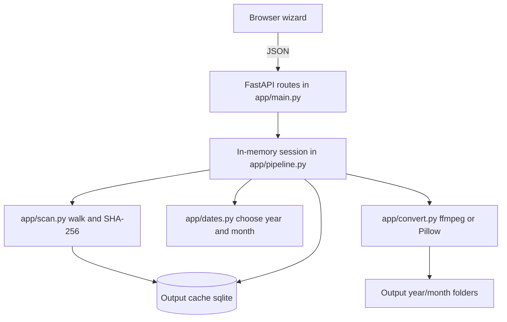
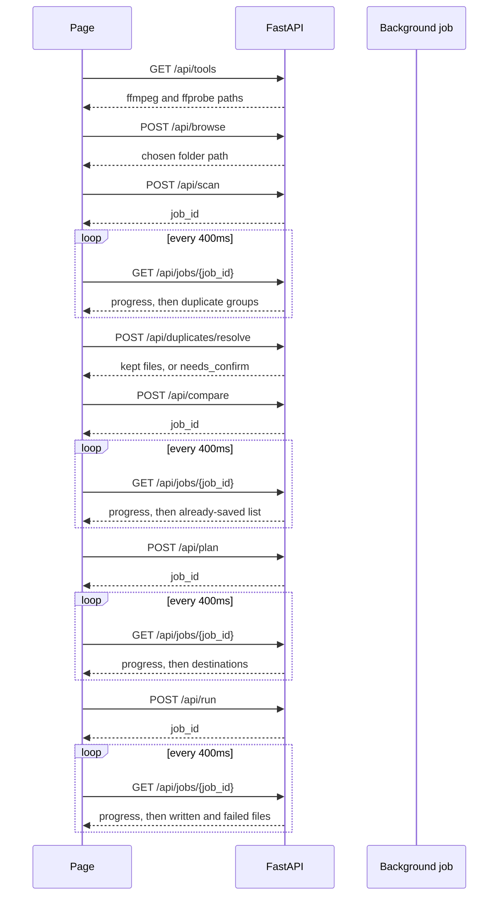

# Home media organizer

A single-user local app. FastAPI serves a browser wizard (`static/index.html` and `static/app.js`). You pick an input folder and an output folder. Nothing in the input folder is deleted, and nothing is written to the output folder, until that step is confirmed. The one exception is the hash cache, `.media_organizer_cache.sqlite`, which is created in the output folder during compare.

Long jobs return a job id. The page polls `GET /api/jobs/{id}` about every 400 ms until the job is `done` or `error`. Duplicate choices are the only step that answers in the same request.

## Data flow

What each stage keeps:

1. **Scan.** Every non-dot file is counted. Only media files are hashed, and only when another file has the same size. Unique sizes stay unhashed until a later step needs the hash. Non-media files are listed and never copied. Dotfiles are ignored completely.
2. **Resolve.** One keeper stays per duplicate group. Ignored extras stay on disk and leave the run. Deletes run only after a second confirmation, and only in the input folder.
3. **Compare.** A kept file is already saved when its SHA-256 matches any output file, or when this app already converted that exact input and the destination file is still there. A copy stored under a year that has not happened yet does not count as saved. Files in a future year folder are removed when the corrected copy is written.
4. **Plan.** Each remaining file gets an action and a destination `{output}/{YYYY}/{MM}/{name}.jpg` or `.mp4`. Two inputs that share that exact path, such as `IMG_9473.jpg` and `IMG_9473.HEIC`, or `IMG_2304.mp4` and `IMG_2304.MOV`, use one destination. No `_2` or `_3` name is created.
5. **Run.** Up to four files are converted or copied at once. A pair that shares a destination runs in one worker: the straight copy first, then the conversion, so the converted HEIC or MOV replaces the copied JPG or MP4. Each finished file updates the cache with its output hash and the source hash.

## How the page calls the API

| Call                           | Body                                            | Returns                                          | What it does                                                                                           |
| ------------------------------ | ----------------------------------------------- | ------------------------------------------------ | ------------------------------------------------------------------------------------------------------ |
| `GET /api/tools`               | none                                            | `{ffmpeg, ffmpeg_found, ffprobe, ffprobe_found}` | Checks Windows `PATH` when the page loads.                                                             |
| `POST /api/browse`             | `{kind: "input" or "output", initial}`          | `{path}`                                         | Opens the native folder dialog. An empty path means Cancel.                                            |
| `POST /api/scan`               | `{input_dir}`                                   | `{job_id}`                                       | Counts all files, hashes media duplicate candidates, returns groups, type counts, and non-media files. |
| `GET /api/jobs/{job_id}`       | none                                            | `{state, done, total, message, result}`          | Progress for scan, compare, plan, and run. `state` is `running`, `done`, or `error`.                   |
| `POST /api/duplicates/resolve` | `{decisions: [{path, action}], confirm_delete}` | result, or `{needs_confirm, delete_paths}`       | `action` is `keep`, `ignore`, or `delete`. Deletes wait for `confirm_delete: true`.                    |
| `POST /api/compare`            | `{output_dir}`                                  | `{job_id}`                                       | Input and output must be separate. Returns already-saved files and the files still to place.           |
| `POST /api/plan`               | none                                            | `{job_id}`                                       | Reads dates and builds destinations. Nothing is written.                                               |
| `POST /api/run`                | none                                            | `{job_id}`                                       | Converts and copies. Refuses to start if ffmpeg is missing and any file needs it.                      |

Only one job runs at a time. The session lives in memory, so restarting uvicorn clears the wizard.

## Wizard

1. **Folders.** Text paths plus Browse. The input and output folders must be separate, and neither may sit inside the other.
2. **Duplicates.** Media files with the same bytes form a group. Keep one. Ignore or delete the extras. Non-media files are shown with a count per extension and are not copied. Names that start with `.` never appear.
3. **Already in output.** A file matches by SHA-256, regardless of its name or folder. A converted file also matches by the source hash stored in the output cache, because the JPG or MP4 bytes differ from the HEIC or MOV. Show the ignored list, then continue.
4. **Copy plan.** Each row shows the action, the date source, the chosen time, and the destination. Files with no picture or video data are skipped here and are not sent to ffmpeg.
5. **Run.** The button converts and copies. Compatible JPG and MP4 files are copied. Other images become JPG, including PNG. Other videos become H.264/AAC MP4. A file that already has the destination name is replaced.

## What gets converted

Images to `.jpg`: `.heic`, `.jpeg`, `.jpg`, `.png`, `.gif`, `.webp`, `.bmp`, `.tiff` / `.tif`.

Videos to H.264/AAC `.mp4`: `.mov`, `.m4v`, `.avi`, `.mts`, `.mpg`, `.mpeg`, `.mp4`, `.mkv`, `.wmv`, `.3gp`, `.flv`, `.webm`.

Extensions are compared without case, so `.PNG` and `.MOV` are included.

- A `.jpg` or `.jpeg` whose first bytes are the JPEG marker is copied unchanged.
- An `.mp4` that is already H.264, and whose playable audio is AAC, is copied as-is.
- Another container that is already H.264 and AAC is remuxed. If remux fails, it is transcoded.
- Other images go through ffmpeg. If ffmpeg cannot read the file, Pillow writes the JPG. `pillow-heif` lets Pillow open HEIC.
- Other videos are transcoded with ffmpeg: `libx264`, CRF 18, `medium`, `yuv420p`, AAC when the audio is not already AAC, `+faststart`.
- iPhone spatial audio (`apple_apac`) is skipped. The normal AAC track is copied. If no playable audio can be decoded, the MP4 is written with picture only.
- A file named like a picture or video that has no readable picture or video data is skipped. That includes an all-zero JPG and a 0-byte AVI.
- ffmpeg is given a normal Windows path. The `\\?\` prefix is used only for paths longer than 240 characters or UNC paths. Temporary output is `{name}.converting.jpg` or `.mp4`, then renamed onto the destination.

Hashing uses up to 8 workers. Conversion uses up to 4 workers, and each x264 encode uses a share of the CPU so the total stays near the processor count.

## Dates and folders

A date stored in the file wins. The file name and the folder name are not used.

- Images: `DateTimeOriginal`, then `CreateDate`, then `DateTimeDigitized`, then `DateTime`.
- Videos: container creation time from ffprobe. A date in the future is ignored. Google Photos uses `2036-01-01` as a placeholder; the audio and video stream creation time is used instead.
- If the file has no usable stored date: the older of the Windows created time and modified time. A later copy onto this disk does not replace an older modified time.

Destination:

`{output}/{year}/{MM}/{name}.jpg` or `.mp4`

Example: a photo with `DateTimeOriginal` of 19 July 2004 becomes `2004/07/IMG_1234.jpg`. A JPG with no stored date and a modified time of 12 March 2006 becomes `2006/03/01-14-06_1639.jpg`.

If that name is already in the output folder, the new file replaces it. The same is true for two files in one run that would land on the same name.

After each write, image EXIF is copied onto the new JPG when it fits, video container metadata is mapped from the source, and the file’s created and modified times are set to the chosen date.

## Project layout

- [app/main.py](app/main.py) — FastAPI routes and the folder dialog
- [app/scan.py](app/scan.py) — walk, hash, duplicate groups, output hash index, import table
- [app/dates.py](app/dates.py) — stored date, then the older file time; year/month paths
- [app/convert.py](app/convert.py) — ffmpeg / Pillow conversion and timestamp fix
- [app/pipeline.py](app/pipeline.py) — wizard session, jobs, and the confirmed run
- [static/index.html](static/index.html), [static/app.js](static/app.js), [static/styles.css](static/styles.css) — the wizard UI
- [requirements.txt](requirements.txt) — FastAPI, uvicorn, Pillow, pillow-heif
- [README.md](README.md) — install, `uvicorn`, and the ffmpeg requirement

The output cache has two tables. `file_hash` stores path, size, modified time, and SHA-256 so unchanged output files are not hashed again. `imported` stores the source SHA-256 and the destination path so a converted file is recognized on the next run even though its bytes changed.

Run from the project folder:

`uvicorn app.main:app --host 127.0.0.1 --port 8000`

Open `http://127.0.0.1:8000`. Restart that process after code changes so the wizard loads the new behavior.